# Asset pipeline compatibility with the game engine

- **Status:** Guidance
- **Owner:** Project owner
- **Last reviewed:** 2026-11-18
- **Related ADRs:** ADR-035, ADR-045, ADR-055, ADR-064, ADR-066 (reserved), ADR-070 (reserved, collision)
- **Related tickets:** LAI-ENG-002, LAI-LAMBDA-002, LAI-LAMBDA-010, LAI-LAMBDA-014, AM-11, AM-16
- **Canonical sources:** [ASSET_LIBRARY](../ASSET_LIBRARY.md), [asset-standard](../adventures/asset-standard.md), [THREE_WORLD_ASSET_CONVENTIONS](../THREE_WORLD_ASSET_CONVENTIONS.md), [processing/CANONICAL_PATH](../processing/CANONICAL_PATH.md), [release-policy](../engineering/release-policy.md#asset-and-content-publication)

Review of the asset pipeline against the engine package (`game/`, Proposed) and the realm
branches. This review changes nothing. Every previously approved Lambda architecture decision
stands: ADR-064's one canonical path, zip-packaged arm64 workers, no ECR in dev, the owner's
2026-11-18 approvals on LAI-LAMBDA-002, 010 and 014, and no deployment.

## 1. Pipeline as it stands

```mermaid
flowchart LR
  A["Staff upload<br/>Django Admin"] --> V["Synchronous GLB validation<br/>apps/assets/validation.py"]
  V --> AV["AssetVersion (unpublished)<br/>S3 key assets/models/<asset>/<version>/model.glb<br/>written once, IfNoneMatch"]
  AV -- "apps.jobs outbox -> SQS media queue" --> W["lambda/jobs_worker<br/>asset.validate_model (PR #42)"]
  W -- "derived artifacts (LAI-LAMBDA-014, branch)" --> DA["staff-only artifact"]
  DA -- "explicit promotion" --> AV2["NEW unpublished AssetVersion"]
  AV --> P["Staff publish gate"]
  AV2 --> P
  P --> R["Resolver: GET children/<id>/assets/<br/>url, format, clips, collision"]
  R --> E["React host -> engine (resolved refs only)"]
```

## 2. Compatibility review

| Concern | Current state | Compatible with the engine? | Action (owner of action) |
|---|---|---|---|
| GLB processing | Synchronous validator on upload (chunks, counts, limits, `extensionsRequired`); Lambda `asset.validate_model` with parity tests (PR #42, Pending merge) | Yes. The engine receives only published versions | None. Keep validator and processor parity (LAI-LAMBDA-002) |
| Mesh optimization | Meshopt first, then KTX2, **only after** loader and both validators support them (owner, 2026-11-18). Today the validator rejects decoder extensions (`needs_decoder`). The React loader sets no Meshopt, KTX2 or Draco decoder | Not yet. Turning on optimized output before the engine loader registers `MeshoptDecoder` would publish models the game cannot load | Sequence: engine loader support (engine agent, `game/assets`) and validator allow-list together, then LAI-LAMBDA-010 output. Draco not authorized |
| Texture optimization | KTX2 planned after Meshopt; image conversion (013a, Pillow) preserves texture values | Not yet (needs `KTX2Loader` and a transcoder asset served with the site) | Same gate as Meshopt. The transcoder files are a site asset and a deploy-path change |
| Collision profiles | `CollisionProfile` on asset or version; resolver returns boxes; client maps them onto the controller's axis-aligned colliders (`0003_collision_profiles`, Pending merge on the Treasure Rush lineage) | Yes, if `derivedColliders.ts` and `applyCollisionProfiles` move into `game/` together with the controller in LAI-2102 | Engine agent: move as one unit. Migration collision with `0003_derived_artifact`: [integration plan](integration-plan-game-engine-core.md#3-django-migration-coordination) |
| Animation metadata | Validator extracts clip names against `CLIP_VOCABULARY`, which mirrors `react/src/features/island-map/three/assets/animationVocabulary.ts` | Yes, but the mirror is a cross-language contract | When `animationVocabulary.ts` moves to `game/`, update the path in the validator comment, and keep a test that compares the two lists |
| S3 delivery | Private bucket per environment, immutable version keys; `LAI_ASSET_DELIVERY=django` (stream) or `s3` (presigned, TTL) | Yes. The engine treats a URL as opaque and short-lived; it must not cache URLs across sessions | Engine cache key = asset id + version id, never the URL |
| CloudFront caching | Site only: hashed bundle files cached one year, `index.html` no-cache, `/api/*` never cached. Assets are **not** behind CloudFront; signed CloudFront (AM-11) is deferred | Yes. Engine code ships in the hashed bundle, so a release invalidates it by file name | None now. If AM-11 is approved later, version-keyed paths already make long TTLs safe |
| Asset versioning | `AssetVersion` UUID in the key; publish switches which version the resolver returns; promotion creates a new unpublished version, never an overwrite | Yes | Engine and region manifests reference asset ids, never version URLs |
| Publication gates | Staff-only publish in Django Admin; derived artifacts never publish automatically (LAI-LAMBDA-014); content import never silently overwrites edits (ADR-047) | Yes | Integration checks below |
| Existing Lambda processing | ADR-064 canonical path; Wave 4 and derived artifacts on PRs #42, #43 and stacked branches; production rollout not authorized | Unchanged by engine work | None. Engine work adds no Lambda, queue or stack |

## 3. Integration checks to prepare (run at authorized merge readiness)

| Check | Command or evidence | Proves |
|---|---|---|
| Validator rejects decoder extensions until enabled | `pytest lai/apps/assets/tests/test_validation.py` | No unloadable model is published |
| Validator and Lambda parity | `pytest tests/processing` (on the Lambda branch) | One verdict on both paths |
| Clip vocabulary mirror | Test comparing `CLIP_VOCABULARY` with `animationVocabulary.ts` (to add when the file moves) | Animation names agree |
| Collision profile boxes | Collision unit tests (Django and Vitest) on the Treasure Rush lineage | Shapes map onto controller boxes |
| No URL caching in the engine | Vitest over the engine asset cache (key is id + version) | Presigned TTL expiry cannot break play |
| Bundle | `npm run build`, one `three` copy, no playground chunk | Engine ships once, dev code excluded |

## 4. Not authorized by this review

Deploying any stack, enabling `LAI_ASSET_ASYNC_VALIDATION`, enabling Meshopt, KTX2 or Draco
output, adding a CloudFront distribution for assets, or creating ECR repositories.
