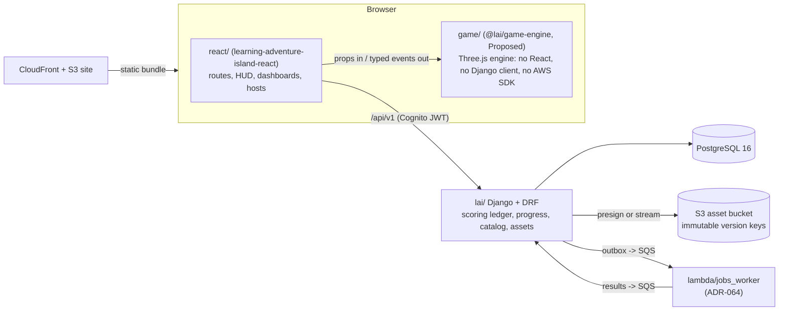
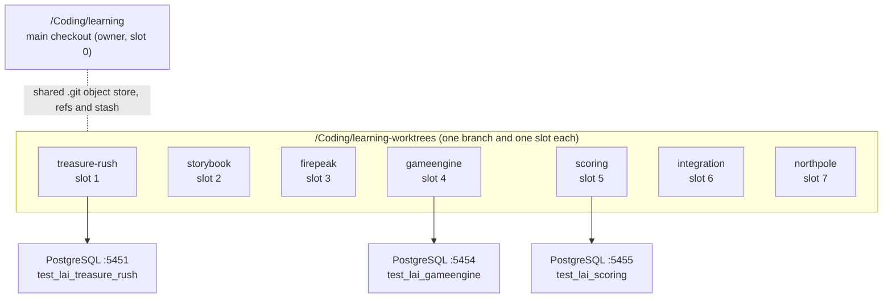

# Engineering infrastructure: audit, ownership and dependencies (Game Engine Core)

- **Status:** Guidance
- **Owner:** Project owner
- **Last reviewed:** 2026-11-19
- **Related ADRs:** ADR-020, ADR-033, ADR-055, ADR-063, ADR-064, ADR-070, ADR-072
- **Related tickets:** LAI-ENG-002, GE-100, LAI-2003, LAI-2101, LAI-2102
- **Canonical sources:** [multi-agent-workflow](../engineering/multi-agent-workflow.md), [integration-policy](../engineering/integration-policy.md), [release-policy](../engineering/release-policy.md), [TESTING_STRATEGY](../TESTING_STRATEGY.md), [THREEJS_ENGINE_CONVERSION](../THREEJS_ENGINE_CONVERSION.md)

This is the hub for the engineering infrastructure that the Game Engine Core work and the six
concurrent agent sessions rely on. Policy stays in `docs/engineering/` (Mandatory policy, owner
approved). This set of documents records evidence and gives operating detail. It does not
restate policy.

| Document | Covers |
|---|---|
| This page | Phase 1 audit, diagrams, agent ownership matrix, dependency matrix, known blockers, policy conflicts |
| [multi-agent-local-environment.md](multi-agent-local-environment.md) | Worktrees, slots, ports, test databases, environment, dependency installation, resources, handoff |
| [game-engine-package.md](game-engine-package.md) | Proposed: `game/` as `@lai/game-engine`, package boundaries, tests, build order, versioning |
| [asset-pipeline-engine-compatibility.md](asset-pipeline-engine-compatibility.md) | GLB processing, optimization, collision profiles, animation metadata, S3, CloudFront, publication gates |
| [integration-plan-game-engine-core.md](integration-plan-game-engine-core.md) | Branch dependencies, merge sequencing, migration and ADR coordination, integration, release and rollback checklists |

Implementation labels follow [documentation-policy](../engineering/documentation-policy.md):
**Implemented (main)**, **Pending merge (branch)**, **Proposed**. Evidence was read from the
repository on 2026-11-18 at `origin/main` `8bd19fb7` and from the remote branch heads named below.

## 1. Engineering audit (Phase 1)

| Area | Finding | Evidence | Status |
|---|---|---|---|
| Repository structure | `react/` (Vite app), `lai/` (Django), `infra/` (CDK), `lambda/` (zip worker), `server/` (multiplayer), `scripts/`, `content/`, `tests/`. No `game/` yet | `ls` at `8bd19fb7` | Implemented (main) |
| npm workspaces | One workspace, `react`. The root `package.json` repeats every `react` dependency with identical ranges (the root also holds `server/` and `infra/` dependencies). Lockfile lists `""` and `react` only | `package.json`, `package-lock.json` | Implemented (main) |
| GitHub Actions | `ci.yml`: ADR check, docs check, admin-preview check, typecheck, lint, format, Vitest, build; e2e job; Python job with a PostgreSQL 16 service. Four `deploy-*` workflows start on `main` pushes behind repository variables | `.github/workflows/` | Implemented (main) |
| Build pipeline | `npm run build` = `tsc -b && vite build` in `react/`. `npm run typecheck` also checks `scripts/`, `server/`, `infra/` | `react/package.json` | Implemented (main) |
| Unit-test configuration | Vitest in `react/vite.config.ts` (jsdom; includes `react/src`, `server/`, `infra/`). pytest from `pyproject.toml` (`tests`, `lai`; `config.settings.test`). Policy: by path, `--maxWorkers=2` | `react/vite.config.ts`, `pyproject.toml` | Implemented (main) |
| Django test databases | pytest-django creates and **drops** `test_<POSTGRES_DB>` on loopback. Every worktree defaulted to `POSTGRES_DB=lai` on port 5442, so concurrent runs shared `test_lai` and could destroy each other's database. Direct `pytest <path>` runs did not read `.env` | `lai/config/settings/test.py`, `lai/conftest.py` | **Fixed on this branch** (per-worktree slot, [local environment](multi-agent-local-environment.md)) |
| Local development | PostgreSQL 5442 (compose, one container per worktree directory name), Django 8010, Vite 5183, Playwright acceptance 8765/5175, multiplayer 2567. Every worktree used the same ports. `make web` did not pass `VITE_DEV_PORT` | `Makefile`, `docker-compose.yml` | **Fixed on this branch** |
| Git worktrees | 25 linked worktrees under `/Coding/learning-worktrees/`; six interactive agent sessions (tmux `lai-*`). Names predate the `wt-<branch>` convention. `core/gameengine` and `core/ge-scoring` do not match a branch-policy pattern | `git worktree list`, `tmux ls` | Legacy names, recorded |
| Asset delivery | Django asset library; S3 private bucket per environment with immutable version keys; delivery `django` (default) or `s3` presigned; **no CloudFront for assets** (decision in `docs/ASSET_LIBRARY.md`) | `infra/lib/assetStorageStack.ts`, `lai/config/settings/base.py` | Implemented (main), not deployed |
| S3 and CloudFront | React site: private S3 + CloudFront OAC, hashed files cached a year, `index.html` no-cache, `/api/*` never cached | `infra/lib/frontendStack.ts` | Implemented (main), not deployed |
| Lambda processing | One canonical path (ADR-064): `apps.jobs`, SQS work and results queues, zip arm64 Lambda `lambda/jobs_worker`, transactional outbox, one consumer. Wave 4 and derived artifacts on open branches and PRs #42 and #43 | `docs/processing/CANONICAL_PATH.md` | Implemented (main) in part; rest Pending merge |
| Engineering standards | ADR-072 accepted 2026-11-18: `AGENTS.md`, `docs/engineering/`, `docs/adventures/`, `make docs-check` | `8bd19fb7` | Implemented (main) |
| Engine boundary | LAI-0203 guard over `react/src/features/island-map/three` and NPC engine folders: no React, routing, data clients. No known violations | `react/src/test/engineBoundary.test.ts` | Implemented (main) |
| Earlier infrastructure tickets | LAI-INFRA-001 to 005 deliverables exist on `main` (`inventory.md`, `resource-ownership.md`, `domains-and-hosting.md`, `deployment-design.md`, `reconciliation-report.md`), but four of those cards still sit in Ready for Development on Trello | `docs/infrastructure/` | Trello out of date (owner to reconcile) |

### 1.1 Proposed `@lai/game-engine` package

No branch, worktree or Trello card contains a `@lai/game-engine` or `packages/` layout as of
2026-11-18 (searched every remote branch and the `gameengine` and `scoring` worktrees). The
roadmap already fixes the location: **`game/`, a sibling of `react/`** (LAI-2101, after LAI-2003,
which is marked APPROVAL). The package name `@lai/game-engine` fits that location. A
`packages/game-engine` directory would be a second, conflicting structure, so this work prepares
`game/` only. Details and the coordination note to the engine agent:
[game-engine-package.md](game-engine-package.md).

## 2. Diagrams

### 2.1 Runtime and package architecture (target after LAI-2101; `game/` is Proposed)

### 2.2 Local multi-agent layout (one machine)

## 3. Agent ownership matrix

Agent numbers are the owner's session numbers. Slots are per worktree and match those numbers
where known. Ids `Claude-01` to `Claude-05` are defined by policy; the sixth session has no
policy id (section 6).

| Agent | Session (tmux) | Worktree | Branch | Ticket(s) | Owns | Shared hotspots it changes | Slot |
|---|---|---|---|---|---|---|---|
| 1 | `lai-treasure` | `treasure-rush` | `feature/treasure-rush-palm-trees` | Treasure Rush, LAI-JMP-01/01a/02/03/04, collision profiles, avatars | Treasure Cove, Pirate's Leap, region play | Movement controller, camera, jumping, collision, assets 0003, avatars app, settings, URLs | 1 |
| 2 | `lai-storybook` | `storybook` | `feature/storykeeper-castle-completion` | SC-R*, SC-JMP-* | Storykeeper's Castle | regions 0007/0008, ai 0006, ADR-063, ADR-065 | 2 |
| 3 | `lai-firepeak` | `firepeak` (`northpole` idle) | `feature/firepeak-volcano-adventure` (`feature/north-pole-adventure`) | FPV-*, SEA-04 / NP-* | Firepeak; North Pole | regions 0007 puzzle kinds, seasons app, ADR-070, ADR-080, ADR-081 | 3 (7) |
| 4 (assumed) | `lai-gameengine` | `gameengine` | `core/gameengine` | GE-100 (engine core) | Engine runtime, future `game/` | Shared engine; currently merging Treasure Rush (uncommitted) | 4 |
| 5 | `lai-scoring` | `scoring` | `core/ge-scoring` | GE-100 (GE-101 to 110 scoring) | Scoring ledger, progression | progression, quests migrations; scoring contract | 5 |
| 6 | `lai-infrastructure` | `integration` | `integration/multi-agent-dev` | LAI-ENG-002 | This document set, slot and workspace tooling | Makefile, `ci.yml`, test settings | 6 |

"Agent 4" is read as the Game Engine session because the owner asked to coordinate the engine
package with it. Owner to confirm. Other worktrees (`lambda`, `lc-*`, `lambda-*`, `npc-manager`,
`engineering-standards`, `sc-final-d`) have no running interactive session. Give each one a slot
(8, 9) before running a server or database tests in it.

## 4. Dependency matrix

Rows depend on columns. **C** = contains the column branch's commits; **D** = needs the
column's change merged first; **X** = conflicting change to resolve at merge; blank = independent.
Measured with `git merge-base --is-ancestor` and three-dot diffs on 2026-11-18.

| Branch (head) | Treasure Rush | Pirate's Leap | Firepeak | Scoring | Engine `game/` | Lambda completion |
|---|---|---|---|---|---|---|
| Treasure Rush `420f1afd` (56 ahead, 13 behind) | | C | | | | X (assets 0003) |
| Pirate's Leap `197a9af0` (37 ahead) | | | | | | X (assets 0003) |
| Firepeak `eaa3a4ab` (100 ahead) | C | C | | | | X (assets 0003, ADR-070) |
| North Pole `130880b7` (105 ahead) | C | C | D (shared `fp/*` commits; card says merge Firepeak first) | | | X (assets 0003) |
| Storykeeper `eb2ac90a` (90 ahead, 0 behind) | C (earlier palm-tree base, not the tip) | | X (regions 0007) | | | X (assets 0003) |
| Scoring `core/ge-scoring` (no commits) | | | | | D (Realm SDK adapter, if it lives in `game/`) | |
| Engine `core/gameengine` (no commits; merge in progress) | D (extracts the merged controller) | | D | | | |
| Lambda completion `7483c07a` (140 ahead) | X | X | X | | | |

## 5. Known blockers

| # | Blocker | Affects | Unblocked by |
|---|---|---|---|
| B1 | LAI-2003 (shared engine architecture) is an APPROVAL task and not done; LAI-2101 depends on it | Creating `game/` | Owner approval of LAI-2003, or an owner decision that GE-100 replaces it |
| B2 | ADR-070 is used by Firepeak and by the GLB optimization branch | Merging either | Owner decision (registry row says COLLISION) |
| B3 | Treasure Rush, Firepeak, North Pole and Pirate's Leap still head the jump decision as `## ADR-055`; `main` has ADR-055 as the native dev environment and reserves ADR-063 for the jump decision (Storykeeper already uses ADR-063) | First merge of the Treasure Rush lineage | Rename to ADR-063 by reading content (governance rule 5), on the Treasure Rush branch, before its PR |
| B4 | `assets` has two different `0003` migrations: `0003_collision_profiles` (five game branches, identical file) and `0003_derived_artifact` (Lambda completion) | Whichever merges second | The second branch renumbers to `0004`, depending on the first ([integration plan](integration-plan-game-engine-core.md)) |
| B5 | `regions` has two different `0007` migrations (Storykeeper `0007_castle_director`, `0008_castle_director_catalog`; Firepeak and North Pole `0007_puzzle_kinds_choose_order`) | Storykeeper or Firepeak merge | Second branch renumbers |
| B6 | Every game branch edits `firstPersonController.ts` and `region-play/`; LAI-2102 moves those files into `game/` | Engine extraction | Sequence extraction after the feature branches merge, or freeze them (integration plan) |
| B7 | The `gameengine` worktree has an uncommitted merge of Treasure Rush with conflicts in `docs/ASSET_LIBRARY.md`, `docs/DECISIONS.md`, `docs/IMPLEMENTATION_STATUS.md` | Agent 4's next commit | Agent 4 (not touched by this work) |
| B8 | No GitHub write access from agent sessions (no `gh`, GitHub MCP failing) | Opening PRs | Owner opens PRs from pushed branches |
| B9 | `playwright.config.ts` hard-codes preview port 4173 and `tests/e2e/django_server.py` hard-codes database `lai_e2e` | Two agents running e2e at once | Run e2e and acceptance suites one at a time, only at authorized merge readiness |
| B10 | `deploy-site.yml` triggers on `react/**` and the root manifests, not `game/**` | Site release after `game/` exists | Owner-approved workflow change in the LAI-2101 PR |

## 6. Conflicts with the standards (reported, not resolved)

| Conflict | Standard says | This request says | Handling |
|---|---|---|---|
| Number of agents | `multi-agent-workflow.md`: up to five Claude agents, ids `Claude-01` to `Claude-05` | Six concurrent agents | Conventions here support up to nine slots. This session uses the provisional id `Claude-06` on its card. A policy change is the owner's (PR to `docs/engineering/`) |
| Branch names | `branch-policy.md` patterns | Owner kept `integration/multi-agent-dev`, `core/gameengine`, `core/ge-scoring` | Logical names recorded on the cards. No rename (renaming another agent's branch is prohibited) |
| Engine package location | Roadmap: `game/` | `@lai/game-engine` package | Compatible: `game/` named `@lai/game-engine`. No `packages/` directory |

## 7. Status update (2026-11-19)

Measured against `origin/main` `8bd19fb7` and current branch heads. The rewritten
[integration plan](integration-plan-game-engine-core.md) has the detail.

| # | Blocker (section 5) | Status now |
|---|---|---|
| B1 | LAI-2003 approval before `game/` | `game/` (`@lai/game-engine`) now exists on `core/gameengine` and every engine-lineage branch. The formal LAI-2003 approval is still recorded as open by the engine lead (decision O1) |
| B2 | ADR-070 used twice | Resolved on the branches (Firepeak moved to number 073). `main`'s registry still says COLLISION, and number 073 has no row: registry-only change needed |
| B3 | Jump decision headed ADR-055 | Resolved on `core/gameengine` and downstream. Still open on the PR #26 to #37 branches: merging PR #36 alone fails `adr:check` |
| B4 | `assets 0003` collision | Open: engine lineage (7 branches, identical file) vs Lambda (8 branches). Second to merge renumbers |
| B5 | `regions 0007` collision | Open: Storykeeper renumbers after Firepeak (engine-first order) |
| B6 | Extraction vs open realm branches | Superseded: realm branches merged the engine instead (Firepeak, North Pole, GE-070). Storykeeper is the only realm branch outside it (9 forecast conflicts) |
| B7 | Uncommitted merge in the `gameengine` worktree | Resolved: no merge in progress; the branch is pushed (`219da1b2`) |
| B8 | No GitHub write tooling | Open |
| B9 | e2e shares `lai_e2e` and port 4173 | Open; mitigated by running browser suites one at a time through `test_gate.py --full` |
| B10 | `deploy-site.yml` ignores `game/**` | Fixed on this branch; needs owner acknowledgement as a deploy-workflow change |
| B11 (new) | CI ran no engine tests (`npm run test` is `react/` only) | Fixed on this branch: `test:engine` and `engine:vectors:check` CI steps (`--if-present`) |
| B12 (new) | Host overload: load 11 to 18.6 measured, timeouts cascade | Mitigated: `scripts/dev/test_gate.py` and the Vitest worker default. The cascading file was fixed by its owner (`ecff0a9a`, defect 9OdaKlbs; not yet in `core/gameengine`) |
| B13 (new) | Non-project CPU on the host (`unattended-upgrade` using a core for 100+ minutes; a GitHub Actions runner service installed) | Owner to review; agents do not stop system processes |
| B14 (new) | Production code imports the engine's `debug` entry (`useEngineRuntime.ts`, renderer stats every frame) | Reported to the engine lead, who is moving `rendererStats` from `debug/` to `engine/` (work in progress, not yet pushed); `make workspace-check` warns until then |
