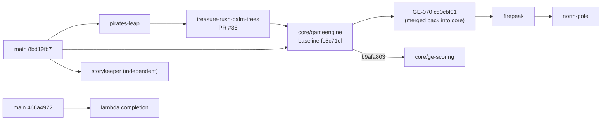

# Integration plan: Game Engine Core and the realm branches (GE-090)

- **Status:** Proposed
- **Owner:** Project owner
- **Last reviewed:** 2026-11-19
- **Related ADRs:** ADR-020, ADR-033, ADR-055, ADR-063 (reserved), ADR-065 (reserved), ADR-070 (reserved), ADR-072, ADR-080 (reserved), ADR-081 (reserved)
- **Related tickets:** LAI-ENG-002, GE-090, GE-001, GE-070, GE-076, GE-100, SEA-04, FPV-*, SC-R*, LAI-LAMBDA-014
- **Canonical sources:** [integration-policy](../engineering/integration-policy.md), [release-policy](../engineering/release-policy.md), [definition-of-done](../engineering/definition-of-done.md), [TESTING_STRATEGY](../TESTING_STRATEGY.md); engine side: `docs/engineering/game-engine/integration-baseline.md` and `engine-1.0-acceptance.md` on `core/gameengine`

**Proposed.** The owner decides the merge order
([integration-policy](../engineering/integration-policy.md#merge-ordering)). This plan supplies
the evidence and the prepared checks. Nothing here merges into `main`. The 2026-11-18 sequence
(scoring contract, then Treasure Rush, then realms, with engine extraction last) is
**superseded**: the engine package now exists, and it already carries the movement stack and
Treasure Rush.

Every number below was measured on 2026-11-19 against `origin/main` `8bd19fb7`, with trial
merges by `scripts/dev/merge_forecast.py`. That script runs `git merge-tree` and writes only
unreferenced objects, so no branch, worktree or ref was changed. Re-measure before acting (section 9).

## 1. Branch heads and ancestry

| Stream | Branch | Head | Ahead / behind `main` | Contains (fully) | Card state |
|---|---|---|---|---|---|
| Engine core | `core/gameengine` | `219da1b2` (baseline `fc5c71cf`) | 128+ / 0 | GE-070, Treasure Rush tip `ce20c90b` (PR #26 to #37), Pirate's Leap | GE-001 In Development |
| Treasure Rush migration | `feature/GE-070-treasure-rush-engine-migration` | `cd0cbf01` | 118 / 0 | Treasure Rush, Pirate's Leap, engine `e9caa3d8` | Development Complete; inside core |
| Movement stack (PR #36) | `feature/treasure-rush-palm-trees` | `ce20c90b` | 61 / 13 | Pirate's Leap | Inside core |
| Pirate's Leap | `feature/pirates-leap` | `197a9af0` | 37 / 13 | none | Inside core |
| Scoring | `core/ge-scoring` | `45b766f8` | 75 / 0 | engine `b9afa803` (67 shared commits) | GE-100 In Development |
| Firepeak | `feature/firepeak-volcano-adventure` | `12246f1f` | 183 / 0 | GE-070 `cd0cbf01`, engine `21119d5d` | FPV cards |
| North Pole | `feature/north-pole-adventure` | `fb9b9af4` | 226 / 0 | Firepeak `12246f1f` and everything in it | SEA-04 In Development |
| Storykeeper's Castle | `feature/storykeeper-castle-completion` | `7906cf50` | 95 / 0 | none (no commit shared with the engine lineage beyond `main`; carries same-content copies of early movement commits) | SC cards |
| Lambda completion | `feature/serverless-processing-completion` | `7483c07a` | 140 / 9 | `feature/lambda-derived-artifacts` | LAI-LAMBDA cards |



None of the realm branches or scoring has yet merged the engine's Wave 2 baseline `fc5c71cf`.
Each takes it by a normal merge (never a rebase) on its own branch.

## 2. Recommended sequence: engine first

| Step | Merge into the integration branch, then `main` | Forecast | Why here | Gate before the step |
|---|---|---|---|---|
| 0 | LAI-ENG-002 (`integration/multi-agent-dev`) | clean | Test gate, slot isolation, CI engine steps, `game/**` site path | Owner review; deploy-workflow acknowledgement (section 7) |
| 1 | `core/gameengine` at its Development Complete SHA. It brings PR #26 to #37, Treasure Rush and GE-070 | **clean** | Provider of `game/`, movement, contracts v1 and the Realm SDK. Resolves the jump decision as ADR-063 | GE-070 owner QA; LAI-2003 approval (or waiver); engine-side ADR number reserved |
| 2 | Scoring, **through `core/gameengine`'s next SHA** (the engine lead merges `core/ge-scoring` @ `49790ce6` or later into core, by owner Wave 2 instruction; agreed 2026-11-19) | Forecast for the separate merge was 1 doc conflict; via core it is resolved once, on core | Scoring contract and `scoring 0001`, no migration collision | GE-100 records Development Complete for the scoring scope in that SHA, with backend pytest on PostgreSQL (slot database); economy values stay off unless approved |
| 3 | `feature/firepeak-volcano-adventure` | **clean** | Contains GE-070; first to add `regions 0007` | number 073 reserved on `main` for Firepeak (section 4) |
| 4 | `feature/north-pole-adventure` | **clean** | Contains Firepeak; adds `seasons 0001` | Step 3 |
| 5 | `feature/storykeeper-castle-completion` | **9 conflicts**: 4 code (`createLocationEngine.ts`, `sceneLayout.ts`, `validateLocationManifest.ts`, `contentExport.test.ts`), 3 generated (`content/exported/islands.json`, `manifest.json`, `tests/golden/director-content.json`), 2 docs | Independent of the engine; renumbers `regions 0007/0008` to `0008/0009` | Its owner merges the integrated result into the castle branch and resolves; generated files regenerated, never hand-merged |
| separate | Lambda completion stream (PRs #42, #43 and stacked) | onto `main` first: 4 doc conflicts; after step 1: **15** (10 code) | Different owner and approvals (ADR-064). Earlier is cheaper for it, but it then renumbers `assets 0003` before the engine lands | Owner chooses; see section 3 |

**The movement stack goes in through the engine, not on its own.** Merged alone,
`feature/treasure-rush-palm-trees` adds a second `## ADR-055` heading (jump), so
`npm run adr:check` fails, and it brings 3 doc conflicts. `core/gameengine` contains that tip and
already applies the owner's 2026-11-17 reconciliation (jump becomes ADR-063). The engine lead's
entry criterion "PR #26 to #36 merged first" therefore needs one of these:
(a) **recommended**: merge the stack through step 1 and close PRs #26 to #37 as merged-via, or
(b) rename 055 to 063 on `feature/treasure-rush-palm-trees` and its PR before merging it.
This is an owner decision (O3/O4 in the engine's `decisions.md`).

Alternatives forecast, and why they are not recommended:

| Order | Cost |
|---|---|
| Storykeeper first | The engine then conflicts in 7 files, Firepeak in 5, North Pole in 4: three owners resolving instead of one |
| Lambda first | 4 doc conflicts for Lambda; then the engine gets 11 (assets app, preview, `createLocationEngine`, `engineHarness`, `regionAssets`), North Pole 1 and Storykeeper 10 |

## 3. Django migration compatibility

`python3 scripts/dev/migration_audit.py` (or `make migration-audit`) on 2026-11-19, 29 branches:

| App | Lineage A | Lineage B | Finding | Resolution |
|---|---|---|---|---|
| `assets` | `0003_collision_profiles` (blob `38188cf0`; engine, scoring, GE-070, Treasure Rush, Firepeak, North Pole, Storykeeper; identical) | `0003_derived_artifact` (`a96ccd90`; Lambda completion and 7 stacked Lambda branches; depends on `jobs 0005`) | COLLISION | Whichever merges second renumbers to `0004_*` with a dependency on the other `0003`. Engine first: the Lambda owner renumbers `0003_derived_artifact` to `0004_derived_artifact` |
| `avatars` (new) | `0001`, `0002` identical on every engine-lineage branch and Storykeeper | none | Clean | Arrives with step 1 |
| `regions` | `0007_puzzle_kinds_choose_order` (`5061e9e4`; Firepeak, North Pole) | `0007_castle_director`, `0008_castle_director_catalog` (Storykeeper) | COLLISION | Storykeeper (step 5) renumbers to `0008_castle_director` and `0009_castle_director_catalog`, the first depending on `0007_puzzle_kinds_choose_order` |
| `scoring` (new) | `0001_initial` (depends on `game_sessions 0007_merge_main`, `users 0008_merge_amplify_exit`, both main leaves) | none | Clean | Step 2 |
| `seasons` (new) | `0001_initial` (`catalog 0010`, `users 0008`) | none | Clean | Step 4 |
| `ai` | `0006_castle_director` (Storykeeper) | none | Clean | Step 5 |
| `jobs`, `audio` | Lambda `0003` to `0005`, `0005` to `0006` | superseded `wave2`/`wave3` branches (`jobs 0002_processing_contract_kinds`, `0003_processing_subject_outcome`) | COLLISION and STALE PARENT, superseded branches only (ADR-064) | None; those branches are reference only and must not merge |

No branch modifies, deletes or renames a migration already on `main` (REWRITE: none), and no two
branches carry different content under one migration name (DIVERGENT: none). The new apps each
add one `INSTALLED_APPS` line in `lai/config/settings/base.py` (`avatars`, `scoring`, `seasons`),
which merge as additive text.

Rules that apply to every resolution:
([integration-policy](../engineering/integration-policy.md#database-models-and-migrations)):
- Renumber only migrations that are not on `main`. A developer database that already applied the
  old name runs `migrate <app> <previous>` and then `migrate` again; that applies only to slot
  databases, since no deployed database has these migrations.
- One leaf per app after every step: `make migrate-check` on the integration branch after each
  merge.

## 4. ADR numbering

| Number | `main` registry | Branches | Status | Action |
|---|---|---|---|---|
| ADR-055 | Accepted: native dev environment | Jump heading still on PR #26 to #37 branches (`shared-jump-controller`, `interactive-platforms`, `third-person-avatar`, `player-running`, `player-avatar-assets`, `asset-collision-profiles`, `pirates-leap`, `treasure-rush-palm-trees`) | **Unresolved on those branches**; resolved on `core/gameengine` and everything downstream | Section 2 option (a) or (b) |
| ADR-056 to 060, 063 | Reserved | Engine lineage, Storykeeper (056 to 059, 063) | Consistent | Headings replace the Reserved rows at step 1 |
| ADR-065 | Reserved | Storykeeper | Consistent | Step 5 |
| ADR-070 | Reserved, marked COLLISION | GLB optimization (Lambda) only; Firepeak moved to number 073 | **Resolved on branches; registry stale** | Registry-only change on `main`: row 070 to the GLB optimization policy |
| 073 (Firepeak's heading on its branch; not an ADR id on `main` yet) | **No row** | Firepeak, North Pole | **Used without reservation** | Registry-only change on `main` reserving 073 for Firepeak before step 3 ([procedure](../engineering/multi-agent-workflow.md#adr-number-reservation)) |
| ADR-080, 081 | Reserved | North Pole | Consistent | Step 4 |
| ADR-NNN (engine core) | none | `core/gameengine` `decisions.md` | Draft | Reserve the next free number on `main` before step 1 |

## 5. Integration branch

Created 2026-11-19 by LAI-ENG-002 at the owner's instruction, in coordination with the engine lead
(Agent 4):

| Item | Value |
|---|---|
| Branch | `integration/20261119-game-engine-core` (pushed; step 1 merged at `673afc0c`, section 5.1) |
| Worktree | `/Coding/learning-worktrees/wt-integration-20261119-game-engine-core` |
| Slot | 8 (PostgreSQL 5458, Django 8090, Vite 5263; pytest database `test_lai_integration_20261119_game_engine_core`) |
| Owner | LAI-ENG-002 (integrating agent). The engine lead supplies SHAs and fixes engine-side conflicts on `core/gameengine` |
| Entry rule | Only branches at Development Complete, at the SHA recorded on their card, by normal merges in section 2 order |
| Never | Deployed, rebased or force-pushed; merged to `main` without the owner |

Procedure per step (dependencies installed once in the worktree with `npm ci` and `make py-install`):

```bash
cd /Coding/learning-worktrees/wt-integration-20261119-game-engine-core
git fetch origin
git merge --no-ff <sha-from-card> -m "Integrate <branch> @<sha> (GE-090)"
python3 ../integration/scripts/dev/migration_audit.py HEAD --base origin/main
make migrate-check && make workspace-check && make docs-check && npm run adr:check
python3 ../integration/scripts/dev/test_gate.py -- npx vitest run <paths the step touched>
```

A step that conflicts in someone else's files stops. The conflict list goes to the owning agent,
who resolves on their own branch; the integration branch then re-merges.

## 6. GE-090 checklists

### 5.1 Step log

| Step | Merged | Result | Open |
|---|---|---|---|
| 1 | `core/gameengine` @ `382b3225` (GE-070 with `ecff0a9a`, GE-075 definitions, GE-066 part 1; each Development Complete on its card) into `673afc0c`, 2026-11-19 | Clean merge (434 files). Migration audit clean, `makemigrations --check` no changes, ADR, docs and workspace checks pass, typecheck clean, engine 588/588. React affected suites through the gate: 2,099 passed, **4 failed** (5 s timeouts) | [Defect ijhrYTi4](https://trello.com/c/ijhrYTi4), **corrected**: not an engine regression. A matched, alternated, exclusive gated measurement shows the integrated tree equal or faster (median 2,172 ms vs 2,421 ms on `main`). Both trees failed the same test in one round during a CPU burst that the 1-minute load average hid. The defect now tracks host contention; the gate also checks PSI CPU pressure |
| 2 | `core/gameengine` @ `ab91d191` (scoring: `core/ge-scoring` @ `49790ce6`, GE-100 Development Complete; Phase 5 stabilization tests; host footstep relay) into `3fe6ede8`, 2026-11-19 | Clean. The merged tree is byte-identical to `ab91d191`, so the engine lead's PostgreSQL 16 run on that tree applies (1,132 passed, 4 skipped: Firepeak and North Pole content-drift checks whose content is not yet merged). Migration audit clean, one leaf per app, ADR, docs and workspace checks pass. Gated: engine 610 passed plus 1 expected fail (GE-L10, platform carry one step late, pinned by `it.fails` and listed in known-defects); scoring, routes and game-engine React 156/156 | ijhrYTi4 (host contention, infrastructure). GE-L10 (Low). Scoring economy off by default (`LAI_SCORING_ENABLED`); the economy ADR is still a draft awaiting the owner |
| 2b | `core/gameengine` @ `2dafd285` (GE-066 recovery and saving, GE-067 shared-host claims; each Development Complete on its card) into `f16f63c1`, 2026-11-19 | Clean; tree identical to `2dafd285`. Migration audit clean, one leaf per app, ADR, docs and workspace checks pass, typecheck clean, engine 610 plus 1 expected fail. React affected suites through the gate: 2,663 passed, 24 failed in 6 files (peak load 10.1, CPU pressure 39.6%). A matched comparison in one exclusive gated session, alternating step 2 (`3fe6ede8`) and step 2b three times on the three failing files at CPU pressure 5 to 8%, passed 35/35 every round on both commits with similar timings: host contention, not step 2b | The failing files were added to ijhrYTi4. The gate's CPU pressure threshold was lowered from 50% to 25% |
| 3 | Firepeak @ `0dbc2e5b` (GE-073, FPV), merged locally as `db6e4392`, **held, not pushed** | Clean merge; migration audit (adds `regions 0007_puzzle_kinds_choose_order`), one leaf per app, ADR, docs, workspace, content, golden and vector checks pass; engine 610 plus 1 expected fail. **Typecheck fails: 5 errors in Firepeak's own test files**, also present on `0dbc2e5b` alone. React: 9 gated failures at 49.5% CPU pressure, which a matched alternation against step 2b showed to be contention (53/53 in all 6 runs) | The Firepeak lead fixes `firepeakRegion.test.ts` (`place()` helper missing quest-count fields) and `useRegionPlay.test.tsx` (mock missing `practice`) and records new SHAs on GE-073 and GE-074 |

Forecast update after step 1: `feature/storykeeper-castle-completion` @ `4df618b2` has merged the
engine and is now **clean** on top of step 1 (it was 9 conflicts). The `regions 0007` collision
with Firepeak remains and is resolved by the order in section 3.

**Owner decision, 2026-11-19 (quoted from the LAI-ENG-002 session): order A, "Firepeak first".**
The steps are core, then Firepeak, then North Pole, then Storykeeper. Storykeeper renumbers
`regions 0007_castle_director` and `0008_castle_director_catalog` to `0008` and `0009` on its own
branch, after Firepeak has reached the integration branch. Forecast onto `3fe6ede8`: core
`2dafd285`, Firepeak `0dbc2e5b` and North Pole `ea5ce8c4` are clean; Storykeeper has 5
conflicts (2 code, 3 generated). The steps still need Development Complete recorded for what each
SHA contains: GE-067 (no card yet), GE-073 and GE-074 (In Development).

### 6.1 Integration checklist (per step)

- [ ] Card at Development Complete; SHA recorded on the card and pushed.
- [ ] The branch has merged the engine baseline it needs (`fc5c71cf` or later), by merge, not rebase.
- [ ] `make merge-forecast REFS="<steps so far> <this branch>"` shows the expected conflicts only.
- [ ] `make migration-audit`: no DIVERGENT, REWRITE or STALE PARENT; collisions resolved per section 3.
- [ ] ADR headings match registry rows; new numbers reserved on `main` first (section 4).
- [ ] `make migrate-check`, `make workspace-check`, `make docs-check`, `npm run adr:check` pass on the integration branch.
- [ ] Unit tests for the touched areas pass through `scripts/dev/test_gate.py`.
- [ ] Shared components and the deployment impact (section 7) listed in the PR.

### 6.2 Merge-readiness gates (prepared; run only when the owner authorizes GE-090)

Run in the integration worktree, one full suite at a time:

| Gate | Command |
|---|---|
| Governance | `npm run adr:check`, `make docs-check`, `make workspace-check` |
| Migrations | `make up && make migrate-check && python3 ../integration/scripts/dev/migration_audit.py HEAD` |
| Types | `npm run typecheck` (engine and app) |
| Lint and format | `npm run lint`, `npm run format:check`, `make py-lint py-format-check` |
| Engine | `python3 ../integration/scripts/dev/test_gate.py --full -- npm run test:engine`, `npm run engine:vectors:check` |
| Frontend | `python3 ../integration/scripts/dev/test_gate.py --full -- npm test` |
| Backend | `python3 ../integration/scripts/dev/test_gate.py --full -- make py-test-db` |
| Content | `npm run content:check`, `npm run golden:check` |
| Build | `npm run build`, then verify: no `GameEnginePlayground` chunk in `react/dist/assets`, and exactly one Three.js copy |
| Browser (authorized only) | `npm run test:e2e`, `npm run test:acceptance`, one at a time on the host |

A test that fails in a gated run is a failure. Only a run that `test_gate.py` reports as
INFRASTRUCTURE (killed by a signal, usually out of memory) may be rerun, and only for the affected
files. Known load flakes (GE-D9, defect 9OdaKlbs) are fixed in their test files, not waived.

### 6.3 Owner acceptance checklist

The engine's own browser checklist is `engine-1.0-acceptance.md` section 3 on `core/gameengine`
(movement, collision, checkpoints, accessibility, hazards, realms, locations, claims, privacy,
performance). Integration adds:

- [ ] Each realm (Treasure Cove, Pirate's Leap, Heart of Firepeak, North Pole, Storykeeper's Castle) completes on desktop and a touch device with progress kept across sessions.
- [ ] Scoring shows pending, then confirmed awards; replaying an action awards nothing new; mistakes and hints cost nothing; economy values off unless approved.
- [ ] Assets with collision profiles behave as before. No published model needs a decoder the loader lacks (Meshopt, KTX2 and Draco are off).
- [ ] The dev playground route `/dev/game-engine` is absent from the deployed site.
- [ ] No child names, free text, audio or identifiers in diagnostics, logs or claims.
- [ ] Owner writes the acceptance line on GE-090; agents never do.

### 6.4 Release checklist

- [ ] Merge-readiness gates in 6.2 passed on the integration branch, with real output attached to GE-090.
- [ ] Owner acceptance recorded (6.3).
- [ ] Release candidate and notes ([release-policy](../engineering/release-policy.md#release-candidates), [template](../engineering/templates/release-notes.md)), engine version noted.
- [ ] Migration review: new apps `avatars`, `scoring`, `seasons`; changes in `assets`, `regions`, `ai`. RDS snapshot before migrating any deployed database ([release-policy](../engineering/release-policy.md#database-migrations)).
- [ ] Deployment approval per environment, separate from the merge approval (section 7).
- [ ] Post-deployment verification ([release-policy](../engineering/release-policy.md#post-deployment-verification)).

## 7. Deployment-trigger analysis

From the canonical table in [release-policy](../engineering/release-policy.md#how-merges-relate-to-deployments).
A push to `main` starts a workflow when it changes a listed path and the workflow's gate variable
is `'true'` (not visible in the repository).

| Merge | `deploy-site.yml` (`react/**`, `game/**`*, `package*.json`) | `deploy-dev-native.yml` / `deploy-django-ec2.yml` (`lai/**`, `content/**`, `react/public/models/**`, `requirements*`) | `deploy-dev-lambda.yml` (`lambda/**`, `lai/apps/jobs/core/**`, `lai/apps/ai/providers/**`) |
|---|---|---|---|
| LAI-ENG-002 | yes (`react/vite.config.ts`; the workflow file itself) | yes (`lai/config/settings/test.py`) | no |
| Step 1 engine | yes | yes (`assets`, `avatars`, `regions` engine bridge, `content/`) | no (0 files at `219da1b2`) |
| Step 2 scoring | yes | yes (`scoring` app) | no |
| Steps 3, 4 realms | yes | yes (`regions`, `seasons`, content) | no |
| Step 5 Storykeeper | yes | yes (`regions`, `ai`) | **yes** (`lai/apps/ai/providers/fake.py`) |
| Lambda stream | yes | yes | **yes** |

\* `game/**` was added on `integration/multi-agent-dev` (blocker B10). Without it, an engine-only
change would never redeploy the site. It is a deployment-infrastructure change, so the owner
acknowledges it before LAI-ENG-002 merges. With `LAI_PROD_AUTO_DEPLOY` `'true'`, the site and
Django `prod` jobs also queue, held for the `*-prod` environment reviewers.

CI coverage of the engine: the root `npm run test` covers `react/` only. `ci.yml` on this branch
adds `npm run test:engine --if-present` and `npm run engine:vectors:check --if-present`, which do
nothing until `game/` is on `main`.

## 8. Rollback

| What | Rollback | Never |
|---|---|---|
| Integration branch | Abandon it and re-create from `main`; it is never deployed | Force-push it after others have read it |
| One integration step | `git revert -m 1 <merge>` on the integration branch, then re-merge after the fix | Reset other people's commits away |
| A merge on `main` | `git revert -m 1 <merge>` on `fix/<ticket>-<slug>` through a PR ([branch-policy](../engineering/branch-policy.md#rollback)) | Reset or force-push `main` |
| Migrations | Roll forward. A revert does not unapply migrations; the owner chooses roll forward or snapshot restore ([release-policy](../engineering/release-policy.md#rollback)) | Edit an applied migration |
| Deployed site or Django | Workflow rollback action with the target SHA (owner or an authorized agent) | Console changes |
| Engine package | Revert the engine merge. Consumers move with it because they live in the same repository | A partial revert that leaves both the old shims and `game/` half-wired |
| Slot or gate settings | `agent_slot.py write --slot 0`; run commands without `test_gate.py` | Touch another worktree's `.env` |

## 9. Re-measuring

```bash
git fetch origin
make merge-forecast REFS="origin/core/gameengine origin/core/ge-scoring \
  origin/feature/firepeak-volcano-adventure origin/feature/north-pole-adventure \
  origin/feature/storykeeper-castle-completion"
make migration-audit
python3 scripts/check_workspace_packages.py --root <exported tree>   # see game-engine-package.md
```
